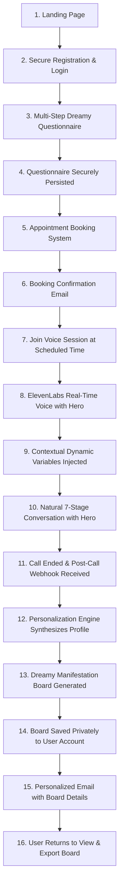
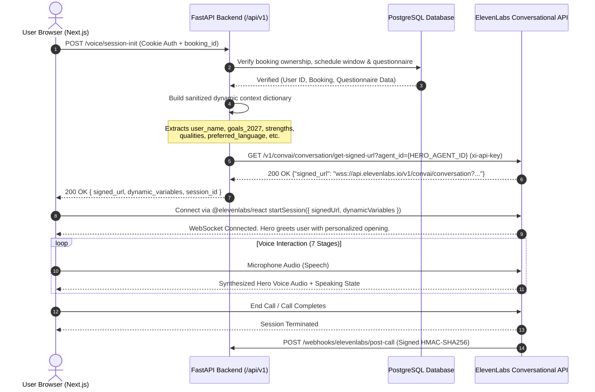

# CONVERSE AI – MANIFEST 2027
## Phase 0: Master Architecture & Implementation Blueprint

**Document Version:** 2.0.0  
**Project Path:** `C:\Users\JANVI\.gemini\antigravity\scratch\converse-ai-manifest-2027`  
**License:** Open Source Permissive (MIT / Apache 2.0 / BSD)  
**Target Environment:** Node.js v26.x, Python 3.11.x, PostgreSQL 16 (production) / SQLite (isolated testing)  

---

## 1. System Overview & Core Product Journey

**Converse AI – Manifest 2027** is an emotionally resonant, personalized manifestation web platform. It moves users through a connected, 16-step journey:



Every stage is unified by a dreamy, celestial visual identity (warm ivory, blush pink, lavender, muted peach, powder blue, champagne accents, elegant typography) rejecting clinical SaaS interfaces.

---

## 2. Technical Stack & Architectural Decisions

### A. Frontend Architecture
- **Framework:** Next.js 14/15 (App Router, React 18/19, TypeScript)
- **Styling:** Tailwind CSS with custom ethereal theme extensions
- **Icons & Assets:** Lucide React (MIT), curated SVG celestial graphics, paper textures
- **Voice SDK:** Official `@elevenlabs/react` (`useConversation` hook) wrapped in a custom dreamy UI
- **Audio Visualization:** Web Audio API (`AudioContext`, `AnalyserNode`) driving audio-reactive canvas waveforms and orb ripples
- **Exporting Engine:** `html2canvas-pro` / `jspdf` for generating high-resolution PNG & PDF downloads of the vision board

### B. Backend Architecture
- **Framework:** Python FastAPI (Python 3.11) with ASGI runner (Uvicorn)
  - *Rationale:* Native support for high-concurrency async endpoints, strict data typing via Pydantic v2, Python-native HMAC signature verification for webhooks, rich data modeling for the personalization engine, and automated OpenAPI/Swagger specifications.
- **Database ORM:** SQLAlchemy 2.0 with Alembic migrations
- **Database Engine:** PostgreSQL 16 (production) with full support for UUIDs, JSONB, and timezone-aware timestamps. Isolated SQLite compatibility layer for automated unit test suites (`pytest`).
- **Security & Crypto:** `pwdlib` / `passlib` with Argon2id password hashing, `python-jose` for JWT tokens, secure `HttpOnly` `SameSite=Lax` cookies.
- **Background Tasks:** FastAPI `BackgroundTasks` / `asyncio` worker for post-call data extraction, board synthesis, and email dispatching without blocking webhook responses.

### C. Voice Integration: ElevenLabs Conversational AI
- **Single Agent Architecture:** A single configured Hero Agent with dynamic variable slots. No per-user agents are created.
- **Security Barrier:** Backend issues short-lived signed WebSocket URLs (`GET https://api.elevenlabs.io/v1/convai/conversation/get-signed-url?agent_id=...`) authenticated by the server-side `ELEVENLABS_API_KEY`. The master API key is never exposed to the frontend.
- **Dynamic Context Injection:** Backend validates session eligibility and constructs a sanitized JSON payload of questionnaire responses, passed securely to the session initiation flow.
- **Post-Call Webhook:** Secure webhook receiver verifying the `ElevenLabs-Signature` header (`t` timestamp + `v0` HMAC-SHA256 signature).

---

## 3. Detailed Component Workflows

### 3.1 ElevenLabs Hero Integration & Context Injection



#### Dynamic Variables Mapping
```json
{
  "user_name": "Sarah",
  "preferred_language": "English",
  "self_description": "Curious, thoughtful creator exploring new creative ventures",
  "current_strengths": "Deep empathy, resilience, strong design thinking",
  "vision_2027": "Leading an independent studio and feeling grounded in nature",
  "desired_identity": "Confident creative director and mindful mentor",
  "career_aspirations": "Launch a design lab supporting meaningful public causes",
  "personal_growth_goals": "Cultivate inner stillness and sustainable daily routines",
  "visual_preferences": "Blush tones, celestial motifs, quiet coastal light",
  "additional_notes": "Transitioning from corporate work; appreciates gentle encouragement"
}
```

### 3.2 Appointment Booking System
1. **Slot Calculation:** Configurable business hours (e.g. 09:00 - 18:00 user local time), 15-minute slot intervals, 10-minute maximum call duration.
2. **Double-Booking Safeguards:**
   - PostgreSQL unique slot index: `CREATE UNIQUE INDEX idx_unique_booking_slot ON bookings (slot_start_time) WHERE status IN ('confirmed', 'in_progress');`
   - Database row-level locking (`SELECT ... FOR UPDATE`) during booking reservation to eliminate race conditions.
3. **Timezone Handling:** All timestamps stored in UTC (`TIMESTAMP WITH TIME ZONE`). Frontend renders dates and times in the user's localized timezone using standard `Intl.DateTimeFormat`.
4. **Call Join Window:** Strict access gate:
   - Call room becomes accessible 5 minutes prior to `slot_start_time`.
   - Access closes 10 minutes after `slot_end_time` if not already initiated.
   - Prevents unauthorized or premature session initiation.

### 3.3 Post-Call Webhook & Verification Engine
1. **Header Parsing:** Extract `t` (Unix timestamp) and `v0` (hex signature) from `ElevenLabs-Signature`.
2. **Replay Protection:** Validate that `|current_time - t| <= 300 seconds` (5 minutes).
3. **HMAC-SHA256 Calculation:**
   $$\text{computed\_hash} = \text{HMAC-SHA256}(K = \text{WEBHOOK\_SECRET}, M = t \,\|\, \text{.} \,\|\, \text{raw\_body\_bytes})$$
4. **Timing-Safe Comparison:** Use `hmac.compare_digest(computed_hash, v0)` to prevent timing attacks.
5. **Idempotency:** Unique database index on `conversation_id`. Duplicate webhook requests return `200 OK {"status": "already_processed"}` immediately.
6. **Transcript Consent Verification:** Transcripts are only stored if the user explicitly checked the transcript retention consent during onboarding; otherwise, only the extracted insights are stored and the raw dialogue turns are discarded.

### 3.4 Personalization Engine
The personalization engine transforms verified user inputs into a structured manifest without inventing unsupported facts:
- **Character / Archetype:** Determined through a transparent rule-and-trait matrix matching the user's stated qualities (e.g., *The Moonlit Creator*, *The Quiet Phoenix*, *The Grounded Architect*, *The Radiant Seeker*).
- **Personalized Quote:** Synthesized directly linking the user's stated 2026/current proud moments to their 2027 vision.
- **Symbolic Element:** Assigned from the 5 classical elements (*Fire*, *Water*, *Earth*, *Air*, *Aether*) with a grounding explanation referencing user responses.
- **Core Qualities & Affirmations:** Stated strengths paired with the growth areas the user articulated.

### 3.5 Manifestation Board Composition
- **Aesthetic Direction:** Dreamy Pinterest-inspired mood board collage with textured polaroids, washi tape effects, golden foil accents, handwritten script notes, and celestial star clusters.
- **Zero-Paid-API Visual Composition:**
  - Dynamic composition layout generator rendering personalized collage cards.
  - Curated, open-licensed visual asset library (Unsplash/Pexels open-access curated photography, public-domain celestial engravings, watercolor textures).
  - High-resolution SVG/Canvas layering engine exportable to PNG (300 DPI) and PDF via client-side rendering.
  - Interactive editing: Users can tweak note text, reposition polaroids, and toggle decorative elements.

### 3.6 Email Delivery Architecture
- **Trigger Condition:** Emails are dispatched **only after** the manifestation board record is successfully persisted in the database.
- **Template Design:** Fully responsive, inline-CSS email matching the platform's dreamy color palette (warm ivory background `#FFF9F3`, lavender accents `#E8E1FA`, plum typography `#40334D`).
- **Development & Production Support:**
  - Development mode: Saves email previews as HTML files to disk (`storage/emails/`) or logs them for instant developer inspection without external credentials.
  - Production mode: Standard SMTP / API integration using standard environment variables (`SMTP_HOST`, `SMTP_PORT`, `SMTP_USER`, `SMTP_PASSWORD`).

---

## 4. Database Schema Specification (PostgreSQL 16)

```sql
-- 1. Users Table
CREATE TABLE users (
    id UUID PRIMARY KEY DEFAULT gen_random_uuid(),
    email VARCHAR(255) UNIQUE NOT NULL,
    hashed_password VARCHAR(255) NOT NULL,
    full_name VARCHAR(120) NOT NULL,
    preferred_language VARCHAR(20) DEFAULT 'en',
    timezone VARCHAR(50) DEFAULT 'UTC',
    is_active BOOLEAN DEFAULT TRUE,
    created_at TIMESTAMP WITH TIME ZONE DEFAULT CURRENT_TIMESTAMP,
    updated_at TIMESTAMP WITH TIME ZONE DEFAULT CURRENT_TIMESTAMP
);

-- 2. User Sessions Table (HttpOnly Cookie Auth)
CREATE TABLE user_sessions (
    id UUID PRIMARY KEY DEFAULT gen_random_uuid(),
    user_id UUID NOT NULL REFERENCES users(id) ON DELETE CASCADE,
    session_token VARCHAR(255) UNIQUE NOT NULL,
    expires_at TIMESTAMP WITH TIME ZONE NOT NULL,
    created_at TIMESTAMP WITH TIME ZONE DEFAULT CURRENT_TIMESTAMP
);

-- 3. Pre-Call Questionnaire Responses
CREATE TABLE questionnaires (
    id UUID PRIMARY KEY DEFAULT gen_random_uuid(),
    user_id UUID UNIQUE NOT NULL REFERENCES users(id) ON DELETE CASCADE,
    preferred_name VARCHAR(120) NOT NULL,
    age_range VARCHAR(50),
    preferred_language VARCHAR(20) DEFAULT 'en',
    self_description TEXT NOT NULL,
    current_stage TEXT,
    happy_triggers TEXT,
    proud_moments TEXT,
    valued_qualities TEXT NOT NULL,
    core_activities TEXT,
    vision_2027 TEXT NOT NULL,
    biggest_dreams TEXT NOT NULL,
    desired_achievements TEXT,
    desired_feeling TEXT NOT NULL,
    desired_identity TEXT NOT NULL,
    life_areas JSONB NOT NULL DEFAULT '{}',
    favorite_colors JSONB NOT NULL DEFAULT '[]',
    favorite_aesthetic VARCHAR(100),
    inspiring_places TEXT,
    visual_preferences TEXT,
    notes_for_hero TEXT,
    excluded_topics TEXT,
    voice_processing_consent BOOLEAN NOT NULL DEFAULT FALSE,
    transcript_storage_consent BOOLEAN NOT NULL DEFAULT FALSE,
    is_completed BOOLEAN NOT NULL DEFAULT FALSE,
    created_at TIMESTAMP WITH TIME ZONE DEFAULT CURRENT_TIMESTAMP,
    updated_at TIMESTAMP WITH TIME ZONE DEFAULT CURRENT_TIMESTAMP
);

-- 4. Bookings & Appointments
CREATE TABLE bookings (
    id UUID PRIMARY KEY DEFAULT gen_random_uuid(),
    user_id UUID NOT NULL REFERENCES users(id) ON DELETE CASCADE,
    slot_start_time TIMESTAMP WITH TIME ZONE NOT NULL,
    slot_end_time TIMESTAMP WITH TIME ZONE NOT NULL,
    status VARCHAR(30) NOT NULL DEFAULT 'confirmed', -- confirmed, in_progress, completed, cancelled, rescheduled
    rescheduled_from_id UUID REFERENCES bookings(id),
    created_at TIMESTAMP WITH TIME ZONE DEFAULT CURRENT_TIMESTAMP,
    updated_at TIMESTAMP WITH TIME ZONE DEFAULT CURRENT_TIMESTAMP
);
CREATE UNIQUE INDEX idx_unique_booking_slot ON bookings (slot_start_time) WHERE status IN ('confirmed', 'in_progress');

-- 5. Voice Call Records
CREATE TABLE voice_calls (
    id UUID PRIMARY KEY DEFAULT gen_random_uuid(),
    booking_id UUID NOT NULL REFERENCES bookings(id) ON DELETE CASCADE,
    user_id UUID NOT NULL REFERENCES users(id) ON DELETE CASCADE,
    elevenlabs_conversation_id VARCHAR(255) UNIQUE,
    status VARCHAR(50) NOT NULL DEFAULT 'initiated', -- initiated, connected, completed, failed, interrupted
    call_duration_seconds INTEGER DEFAULT 0,
    started_at TIMESTAMP WITH TIME ZONE,
    ended_at TIMESTAMP WITH TIME ZONE,
    transcript_stored BOOLEAN DEFAULT FALSE,
    transcript_payload JSONB,
    call_metadata JSONB DEFAULT '{}',
    created_at TIMESTAMP WITH TIME ZONE DEFAULT CURRENT_TIMESTAMP
);

-- 6. Personalization Profiles
CREATE TABLE personalization_profiles (
    id UUID PRIMARY KEY DEFAULT gen_random_uuid(),
    user_id UUID NOT NULL REFERENCES users(id) ON DELETE CASCADE,
    voice_call_id UUID REFERENCES voice_calls(id) ON DELETE SET NULL,
    personality_summary TEXT NOT NULL,
    archetype_title VARCHAR(100) NOT NULL,
    archetype_rationale TEXT NOT NULL,
    personalized_quote TEXT NOT NULL,
    symbolic_element VARCHAR(50) NOT NULL, -- Fire, Water, Earth, Air, Aether
    element_rationale TEXT NOT NULL,
    core_qualities JSONB NOT NULL DEFAULT '[]',
    vision_2027_summary TEXT NOT NULL,
    manifestation_message TEXT NOT NULL,
    generated_at TIMESTAMP WITH TIME ZONE DEFAULT CURRENT_TIMESTAMP
);

-- 7. Manifestation Boards
CREATE TABLE manifestation_boards (
    id UUID PRIMARY KEY DEFAULT gen_random_uuid(),
    user_id UUID NOT NULL REFERENCES users(id) ON DELETE CASCADE,
    profile_id UUID REFERENCES personalization_profiles(id) ON DELETE CASCADE,
    public_share_token VARCHAR(64) UNIQUE NOT NULL,
    title VARCHAR(255) NOT NULL DEFAULT 'My 2027 Manifestation',
    board_theme VARCHAR(50) DEFAULT 'celestial_scrapbook',
    board_state JSONB NOT NULL, -- Cards, polaroids, stickers, affirmations, positions
    is_public BOOLEAN DEFAULT FALSE,
    created_at TIMESTAMP WITH TIME ZONE DEFAULT CURRENT_TIMESTAMP,
    updated_at TIMESTAMP WITH TIME ZONE DEFAULT CURRENT_TIMESTAMP
);

-- 8. Email Delivery Records
CREATE TABLE email_logs (
    id UUID PRIMARY KEY DEFAULT gen_random_uuid(),
    user_id UUID NOT NULL REFERENCES users(id) ON DELETE CASCADE,
    email_type VARCHAR(50) NOT NULL, -- booking_confirmation, board_ready, reminder
    recipient_email VARCHAR(255) NOT NULL,
    status VARCHAR(30) NOT NULL DEFAULT 'pending', -- pending, sent, failed, mocked
    provider_message_id VARCHAR(255),
    error_message TEXT,
    sent_at TIMESTAMP WITH TIME ZONE,
    created_at TIMESTAMP WITH TIME ZONE DEFAULT CURRENT_TIMESTAMP
);
```

---

## 5. Security, Privacy & Compliance Architecture

1. **Authentication Security:**
   - Passwords hashed with Argon2id using recommended OWASP parameters.
   - Protected sessions stored via cryptographically random UUID tokens in `HttpOnly`, `SameSite=Lax`, `Secure` cookies.
   - Backend authorization middleware validates `user_id` ownership on every questionnaire, booking, call record, and manifestation board query.
2. **ElevenLabs Secret Protection:**
   - `ELEVENLABS_API_KEY` and `ELEVENLABS_AGENT_ID` reside strictly on the backend.
   - Frontend requests signed single-use URLs; client bundles never contain administrative tokens.
3. **Webhook Verification & Anti-Tampering:**
   - Raw request body preserved prior to JSON deserialization.
   - HMAC-SHA256 signature checked against `ElevenLabs-Signature` with 5-minute replay window validation.
4. **Data Minimization & User Consent:**
   - Voice processing consent separated from optional transcript storage consent.
   - If transcript storage is declined, raw dialogue turns are excluded from database writes.
   - Dedicated user data export and deletion endpoints provided in account settings.
5. **Prompt Injection & Grounding Safeguards:**
   - User inputs sanitized and passed as dynamic key-value variables, not concatenated into system instructions.
   - Personalization engine validates all fields against strict Pydantic schemas; missing values remain `None` or trigger polite fallbacks rather than hallucinating achievements.

---

## 6. Dependency, License & Cost Analysis

| Component | Technology | License | Commercial Permitted? | Cost / Terms |
| :--- | :--- | :--- | :--- | :--- |
| Frontend | Next.js 14/15, React, TypeScript | MIT | Yes | **$0.00** (Free & Open Source) |
| Styling | Tailwind CSS, Lucide React | MIT | Yes | **$0.00** (Free & Open Source) |
| Backend | Python 3.11, FastAPI, Pydantic v2 | MIT / BSD | Yes | **$0.00** (Free & Open Source) |
| Database | PostgreSQL 16 / SQLAlchemy 2.0 | PostgreSQL / MIT | Yes | **$0.00** (Self-hostable / Local) |
| Voice SDK | `@elevenlabs/react` / `@elevenlabs/client` | MIT | Yes | **$0.00** (SDK is open source) |
| Voice Agent Service | ElevenLabs Conversational AI | Proprietary API | Commercial via Account | Requires active ElevenLabs account. Free tier provides 10,000 credits/mo (~10 mins); paid creator tiers start at $5-$22/mo. *Requires user credentials.* |
| Email Service | Python `aiosmtpd` / standard SMTP | Open Source / RFC standard | Yes | **$0.00** local dev testing; configurable to free-tier SendGrid/Resend or standard SMTP. |
| Board Export | `html2canvas-pro` + `jspdf` | MIT | Yes | **$0.00** (Client-side open source) |

*Zero-Cost Guarantee: All code, libraries, and design assets are 100% open-source and free to run. The only paid external service is the ElevenLabs API for live voice calls, which requires your explicit configuration.*

---

## 7. Phase-by-Phase Implementation Roadmap

- **Phase 0: Project Planning & Architecture** *(Current Phase - Blueprint approval)*
- **Phase 1: Dreamy Website Foundation** (Design system, palette, typography, responsive landing page, navigation)
- **Phase 2: Authentication and Questionnaire** (Registration, login, session cookies, multi-step dreamy questionnaire, autosave)
- **Phase 3: Booking System** (Appointment slots, timezone conversion, double-booking prevention, booking confirmation)
- **Phase 4: ElevenLabs Voice Integration** (Signed URL issuance, dynamic variables injection, custom glowing orb interface, audio-reactive waveform, call lifecycle controls)
- **Phase 5: Post-Call Processing** (HMAC-SHA256 verified webhook, conversation transcript consent handling, structured data extraction)
- **Phase 6: Personalization Engine** (Archetype/character generator, personalized quote synthesis, symbolic element assignment, grounding verification)
- **Phase 7: Manifestation Board** (Dreamy Pinterest-style mood board canvas, polaroids, affirmations, PNG/PDF export, private sharing)
- **Phase 8: Email Delivery** (Personalized HTML email templates, delivery tracking, development preview mode, retry logic)
- **Phase 9: Final Testing and Deployment Readiness** (End-to-end integration tests, security audit, accessibility checks, deployment documentation)

---

## 8. Verification & Review Gates

Prior to advancing to Phase 1, the user must review and approve:
1. The decoupled Next.js + FastAPI architecture.
2. The dynamic variables and signed WebSocket URL security flow for ElevenLabs.
3. The database schema supporting bookings, voice calls, profiles, and boards.
4. The zero-cost development email and local database strategy.
